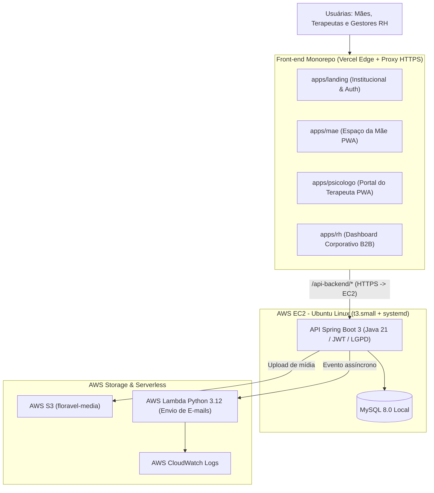

<p align="center">
  
  &nbsp;&nbsp;&nbsp;
  
</p>

# 🌸 Florável — Acolhimento Perinatal & Saúde Emocional Materna

> **Plataforma integrada de apoio à saúde mental materna para gestantes e puérperas, unindo impacto social (B2C) e sustentabilidade corporativa ESG (B2B).**  
> Projeto desenvolvido no **Instituto PROA** para o **Demo Day**, construído com **Java 21 / Spring Boot**, **React 19 Monorepo**, **MySQL 8.0**, **Vercel** e **AWS (EC2, S3 e Lambda)**.

---

## 🌐 Links Oficiais & Portais ao Vivo

| Canal / Aplicação | Link |
| :--- | :--- |
| 📸 **Instagram Oficial** | [@floravel_oficial](https://www.instagram.com/floravel_oficial/) |
| 💼 **LinkedIn da Florável** | [Florável no LinkedIn](https://www.linkedin.com/company/flor%C3%A1vel/?viewAsMember=true) |
| 📄 **Dossiê do Projeto** | *[Inserir link do Dossiê / PDF / Drive aqui](#)* |
| 🌸 **Landing Page Institucional** | [froravel-front.vercel.app](https://froravel-front.vercel.app) |
| 🤱 **Portal da Mãe (PWA)** | [floravel-mae.vercel.app](https://floravel-mae.vercel.app) |
| 🩺 **Portal do Terapeuta / Psicólogo** | [psicologo-blue.vercel.app](https://psicologo-blue.vercel.app) |
| 🏢 **Dashboard Corporativo RH (B2B)** | [rh-lilac-two.vercel.app](https://rh-lilac-two.vercel.app) |

---

## 🏫 1. Onde o Projeto Nasceu
O **Florável** foi idealizado e desenvolvido durante a jornada de formação no **Instituto PROA**, como projeto integrador para o **Demo Day**. Nosso objetivo foi unir **engenharia de software, design centrado no usuário, visão de produto e impacto social** para enfrentar um problema real e frequentemente invisibilizado na sociedade.

---

## 🎯 2. Contexto do Problema & Validação de Produto

### O Cenário
* **Vulnerabilidade no puerpério:** Muitas mulheres enfrentam sobrecarga emocional, solidão e sintomas de depressão pós-parto sem rede de apoio acessível.
* **Barreiras de acesso:** Altos custos de terapia particular, longas filas no atendimento público e estigma social dificultam a busca por ajuda no momento em que a mãe mais precisa.
* **Impacto no mercado de trabalho:** A falta de suporte emocional no retorno da licença-maternidade contribui para a saída precoce de mulheres do mercado corporativo.

### Pesquisa & Descoberta (Discovery Real)
Antes de escrever código, fomos a campo validar a dor com quem vive o problema e com quem atende na linha de frente:
* **👩🏾‍🍼 150 respostas de mães:** Realizamos pesquisa e conversas com mães, obtendo **150 respostas** que confirmaram as dificuldades reais de acolhimento, escuta acessível, falta de tempo e insegurança no puerpério.
* **🧠 Entrevistas com psicólogos(as):** Conversamos com profissionais de psicologia para validar o fluxo clínico, o sigilo ético (normas do CFP), a aplicação da **Escala de Depressão Pós-Parto de Edimburgo (EPDS)** e o formato das rodas de conversa e atendimentos sociais.

---

## 💡 3. A Solução Florável

Um ecossistema digital com quatro frentes conectadas e dois pilares complementares:

1. **Acolhimento Social (B2C — Portal da Mãe & Portal do Psicólogo):**
   * **Triagem Clínica EPDS:** Autoavaliação estruturada com protocolo imediato de acolhimento/emergência (CVV 188 / SAMU 192) quando há sinalização de risco.
   * **Rodas de Conversa & Sala ao Vivo:** Encontros em grupo mediados por psicólogas verificadas pelo CRP, com vídeo integrado e disjuntor de segurança contra condutas abusivas.
   * **Comunidade, Diário & Biblioteca:** Espaço seguro para registro emocional e conteúdos de apoio perinatal.

2. **Sustentabilidade Corporativa ESG (B2B — Dashboard RH):**
   * Empresas patrocinam licenças do programa Florável como benefício de saúde e retenção para colaboradoras mães.
   * O RH acompanha indicadores agregados de adesão e bem-estar por setor sob a regra de **K-Anonimato ($K \ge 5$)**, garantindo que nenhum dado clínico individual da colaboradora seja exposto.

---

## 🛠️ 4. Stacks Utilizadas & Construção do Sistema

### Front-end (Monorepo Workspaces)
<p>
  
  
  
  
  
  
  
</p>

* **Monorepo (`apps/landing`, `apps/mae`, `apps/psicologo`, `apps/rh`):** 4 portais independentes com contratos compartilhados em `packages/shared`, suporte PWA e proxy HTTPS transparente (`/api-backend/*`) na Vercel.

### Back-end & Banco de Dados
<p>
  
  
  
  
  
  
</p>

* **Segurança & LGPD:** JWT Stateless, **BCrypt** nas senhas, **AES-256-GCM** em dados sensíveis, minimização de CPF (salvo apenas mascarado) e **87 testes automatizados** (JUnit 5 + Mockito).

### Cloud & Serverless (AWS)
<p>
  
  
  
  
  
  
</p>

* **Infraestrutura FinOps:** API + MySQL em **EC2 (`t3.small`)** com `systemd`, mídias no **S3 (`floravel-media`)** e disparos assíncronos de e-mail via **Lambda Python** monitorados no **CloudWatch**.

---

## 🏛️ 5. Arquitetura, System Design & Definição de Produto



### Principais Decisões de System Design & Produto
* **Desacoplamento por Domínios:** Back-end organizado por módulos (`auth`, `usuario`, `mae`, `psicologo`, `triagem`, `rodaconversa`, `agendamento`, `denuncia`, `rh`, `storage`).
* **Muralha de Fogo (Privacidade Clínica x RH):** Separação estrita entre os registros de saúde da mãe e os indicadores corporativos do RH (que só enxerga métricas agregadas com $K \ge 5$).
* **Arquitetura Orientada a Eventos (Serverless):** Envio de e-mails desacoplado da thread principal da API para manter baixa latência no cadastro e recuperação de senha.
* **Ética de Produto (Zero "Robô Terapeuta"):** A triagem segue critérios determinísticos da escala EPDS e o acolhimento emocional é conduzido exclusivamente por profissionais humanos.

---

## 👥 6. Integrantes da Equipe

> 📸 *Adicione abaixo a foto da equipe e atualize as fotos e links de LinkedIn individuais de cada integrante.*

<!-- Exemplo para inserir foto da equipe:

-->

| Foto | Integrante | Função no Projeto | LinkedIn |
| :---: | :--- | :--- | :---: |
|  | **Daniel Expedito** | Desenvolvedor | [LinkedIn](#) |
|  | **Luiz Gonzaga** | Desenvolvedor / UX / UI | [LinkedIn](#) |
|  | **Maria Rene** | Desenvolvedora | [LinkedIn](#) |
|  | **Gabriela Glicelio** | Documentarista e Financeiro | [LinkedIn](#) |
|  | **Adrielly Soares** | Product Owner (P.O.) | [LinkedIn](#) |
|  | **Gustavo Kazuhiro** | Desenvolvedor | [LinkedIn](#) |
|  | **Victor** | Scrum Master | [LinkedIn](#) |
|  | **Gabriel** | Desenvolvedor | [LinkedIn](#) |

---

## 🚀 7. Como Executar Localmente

### Pré-requisitos
* **Node.js** $\ge 20$ e **npm** $\ge 10$
* **Java JDK 21** e **MySQL 8.0+** (para executar o back-end localmente)

### Passos (Front-end Monorepo)
```bash
# 1. Clonar o repositório
git clone https://github.com/Daniellramos09/Froravel-Front.git
cd Froravel-Front

# 2. Instalar dependências de todos os workspaces
npm install

# 3. Rodar os portais em ambiente de desenvolvimento
npm run dev:landing    # http://localhost:5173
npm run dev:mae        # http://localhost:5174
npm run dev:psicologo  # http://localhost:5175
npm run dev:rh         # http://localhost:5176

# 4. Build de produção de todos os apps
npm run build:all
```

---

## 🙏 8. Agradecimentos

### À Nossa Equipe
Nosso agradecimento especial a **cada um dos 8 integrantes** que se dedicaram intensamente entre pesquisas com mães e psicólogos, definição de produto, protótipos de UX/UI, documentação, financeiro, código, testes e deploy em nuvem para tornar o **Florável** realidade:

* **Daniel Expedito** — Desenvolvimento
* **Luiz Gonzaga** — Desenvolvimento / UX & UI Design
* **Maria Rene** — Desenvolvimento
* **Gabriela Glicelio** — Documentação & Financeiro
* **Adrielly Soares** — Product Owner (P.O.)
* **Gustavo Kazuhiro** — Desenvolvimento
* **Victor** — Scrum Master
* **Gabriel** — Desenvolvimento

### Aos Professores do Instituto PROA
Agradecemos de coração aos professores que nos acompanharam, orientaram e acreditaram no nosso potencial durante toda essa jornada na **Turma 5 de Java do Instituto PROA**:

* **Gabriel Augusto** — *Professor da Turma 5 de Java do Instituto PROA*: o professor que passou mais tempo ao nosso lado durante toda a formação. Nosso muito obrigado por todos os ensinamentos técnicos, dicas valiosas, paciência e por dedicar tanto do seu tempo ao nosso desenvolvimento profissional e humano.
* **Débora** — Nosso agradecimento especial por todo o apoio na construção e lapidação do **pitch** e por tornar possível as **aulas de AWS** para as turmas do PROA, abrindo portas essenciais para colocarmos o Florável na nuvem.
* **Aurora** — *Professora de Comunicação*: agradecemos imensamente pelas aulas de português, estruturação de currículo e pelas orientações e técnicas que nos prepararam para apresentar o pitch com clareza e confiança.
* **Cláudia** — *Professora de Projeto*: agradecemos pela forma cuidadosa e estruturada como conduziu toda a sequência de entregas até o projeto final e a apresentação do **Demo Day**.

Obrigado a todos por cada feedback e incentivo até chegarmos até aqui! 🌸💚
