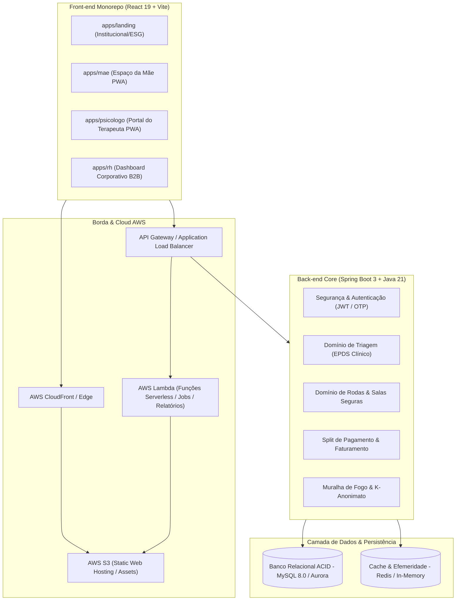

# 🌸 Florável — HealthTech de Acolhimento Perinatal & Saúde Materna

> **Plataforma corporativa e social integrada para detecção precoce, suporte emocional e acolhimento clínico de gestantes e puérperas com foco na prevenção da depressão pós-parto.**  
> Engenharia de Software Full-Stack (Java/Spring Boot + React 19 Monorepo), arquitetura Cloud Serverless (AWS), modelagem de dados desacoplada e conformidade estrita com a LGPD e o Conselho Federal de Psicologia (CFP).

---

## 🎯 1. O Problema & A Solução de Negócio

### O Problema Real
* **1 em cada 4 mães no Brasil** enfrenta depressão pós-parto, com maior incidência e vulnerabilidade entre mulheres periféricas.
* **Barreiras de Acesso:** Custos inviáveis de consultas privadas, filas demoradas na rede básica e estigma social em torno da saúde mental puerperal.
* **Cenário Corporativo B2B:** Quase 50% das mulheres saem do mercado de trabalho nos primeiros 24 meses pós-licença-maternidade por falta de apoio à saúde emocional e sobrecarga materna.

### A Solução Florável
Um ecossistema digital integrado com dois pilares de sustentabilidade:
1. **Impacto Social (B2C):** Mães realizam triagens clínicas validadas, participam de rodas de conversa em grupo mediadas por psicólogas voluntárias e acessam consultas individuais a custo social ético.
2. **Sustentabilidade Financeira (B2B Corporativo):** Empresas contratam o programa de apoio materno como benefício de retenção de talentos e ESG. O RH acompanha indicadores agregados de clima sem jamais violar a intimidade da colaboradora.

---

## 🏛️ 2. Arquitetura do Sistema & System Design

O ecossistema é dividido em uma arquitetura desacoplada de alto desempenho:



### Decisões de System Design
* **Frontend Monorepo (Workspaces):** Quase 4 aplicações independentes (`landing`, `mae`, `psicologo`, `rh`) compartilhando design tokens, tipagens e contratos de navegação (`packages/shared`).
* **Clean Architecture & DDD no Back-end:** Domínios isolados por responsabilidade única (`triagem`, `agendamento`, `reuniao`, `rh`, `pagamento`).
* **Muralha de Fogo (Database Firebreak):** Separação lógica e física entre os dados clínicos de saúde da mãe e as métricas contratuais do RH.

---

## ☁️ 3. Cloud Architecture (AWS, S3, Lambda & Infraestrutura)

Para garantir escalabilidade com custo operacional otimizado para o modelo de impacto social:

1. **AWS S3 (Simple Storage Service):**
   * Hospedagem estática com alta disponibilidade e distribuição global via CloudFront CDN.
   * Armazenamento seguro de comprovantes de registro profissional (CRP) criptografados com *Server-Side Encryption* (SSE-KMS).
2. **AWS Lambda (Serverless Compute):**
   * Processamento sob demanda de relatórios corporativos consolidados de RH (evitando sobrecarga do servidor transacional).
   * Webhooks assíncronos de gateways de pagamento (liquidação de PIX e split de repasses).
   * Jobs cronometrados para encerramento de salas de apoio e limpeza de sessões expiradas.
3. **AWS CloudWatch & Logs:**
   * Trilha de auditoria e monitoramento de integridade sem registro de PII (*Personally Identifiable Information*).

---

## 🤖 4. IA Aplicada à Engenharia & Governança de Produto

A inteligência artificial na Florável foi aplicada com foco em **Produtividade de Engenharia** e **Ética Rigorosa**:

* **AI-Assisted Engineering (Pair Programming & Automação):**
  * Uso de agentes de IA para aceleração do ciclo de vida: modelagem ágil da base relacional, suporte na cobertura de **+80 testes unitários automatizados** (JUnit 5 / Mockito) e resolução rápida de incompatibilidades de build em ambiente Linux/Vercel.
* **Segurança e DevSecOps em Código Assistido:**
  * Prevenção de alucinações e riscos de segurança utilizando pipelines com análise estática de código (SAST) e verificação de segredos e dependências vulneráveis (princípios Semgrep, TruffleHog e Trivy).
* **Decisão Ética de Produto (Zero "Robô Terapeuta"):**
  * Acolhimento em saúde mental não utiliza LLMs abertos ou probabilísticos na resposta direta a pacientes em vulnerabilidade. 
  * A triagem clínica segue rigor determinístico da **Escala de Edimburgo (EPDS)**, e todo o suporte emocional é realizado **exclusivamente por psicólogas humanas**.

---

## 🗄️ 5. Modelagem de Banco de Dados & LGPD

O banco de dados relacional (MySQL 8.0) foi desenhado em **4 núcleos desacoplados**:

```text
1. NÚCLEO IDENTIDADE & ACESSO
   ├── usuarios (id, email, senha_hash, perfil, status)
   └── responsaveis_legais (vínculo 1:1 para mães de 14 a 17 anos - ECA/LGPD Art. 14)

2. NÚCLEO CLÍNICO & ESCUTA (SIGILO MÉDICO ABSOLUTO)
   ├── triagem_edimburgo (id, usuario_id, escore_total, alerta_ideacao_q10, data_criacao)
   ├── respostas_edimburgo (triagem_id, questao_id, pontuacao)
   └── denuncias (codigo_publico_flr, motivo, status, data)

3. NÚCLEO DE INTERAÇÃO & COMUNIDADE
   ├── psicologos (crp, bio, especialidade, valor_social)
   ├── rodas_conversa (tema, facilitadora_id, data_hora, limite_vagas)
   └── agendamentos (mae_id, psicologo_id, data_hora, status)

4. NÚCLEO CORPORATIVO B2B (MURALHA DE FOGO DO RH)
   ├── empresas (cnpj, razao_social, plano_ativo)
   └── licencas_colaboradoras (empresa_id, hash_funcional, setor, status)
```

### Regras de Ouro de Segurança e Dados:
* **Zero ENUM no Banco:** Validações de domínio controladas na camada de aplicação para evitar bloqueios de tabela (*table lock*) em migrações.
* **Sem Foreign Key entre RH e Clínico:** O RH tem acesso apenas a agregações anônimas. Nenhuma chave do banco permite ao gestor saber quem respondeu o questionário de depressão pós-parto.
* **Anonimização de Denúncias:** O código público exibido em tela utiliza identificadores opacos (ex: `#FLR-8921`), impedindo que IDs sequenciais de banco de dados exponham usuárias.

---

## 📋 6. Requisitos de Engenharia (RF, RNF e Regras de Negócio)

### 📌 Requisitos Funcionais (RF)
* **[RF01] Triagem EPDS:** O sistema deve aplicar o questionário clínico de 10 perguntas da Escala de Depressão Pós-Parto de Edimburgo.
* **[RF02] Protocolo de Emergência:** Disparo imediato de rota de acolhimento (CVV 188 / Chat Silencioso) se a **Questão #10** for positiva ($>0$).
* **[RF03] Rodas de Conversa:** Gestão de salas virtuais com limite de participantes e facilitação profissional.
* **[RF04] Split de Pagamento:** Divisão do valor da consulta social no gateway financeiro, repassando a maior parte à psicóloga e retendo taxa administrativa mínima sem bitributação.
* **[RF05] Dashboard de Gestão do RH:** Relatórios de saúde corporativa por departamento e taxa de engajamento do benefício materno.

### ⚙️ Requisitos Não Funcionais (RNF)
* **[RNF01] Privacidade & LGPD (Art. 11):** Tratamento rigoroso de dados sensíveis de saúde mental com Termo de Consentimento Livre e Esclarecido (TCLE).
* **[RNF02] K-Anonimato ($K \ge 5$):** Em relatórios corporativos, nenhum setor com menos de 5 colaboradoras pode ter suas métricas discriminadas individualmente.
* **[RNF03] Performance e Latência:** TTFB (Time to First Byte) inferior a 150ms nas consultas transacionais com índices B-Tree compostos e cache de leitura.
* **[RNF04] Multi-tenant Seguro:** Isolamento estrito de dados entre diferentes empresas clientes no ambiente corporativo.
* **[RNF05] Responsividade PWA:** Funcionalidade plena em dispositivos móveis populares e conexões instáveis.

### ⚖️ Regras de Negócio (RN)
* **[RN01] Validação com Conselho Profissional:** Psicólogos só atendem na plataforma após conferência de registro ativo e regular junto ao CFP/e-Psi.
* **[RN02] Proteção de Menores (ECA Art. 17):** Mães adolescentes (14 a 17 anos) cadastram autorização de responsável legal via OTP, mas seus relatos e questionários são sigilosos e não ficam acessíveis aos pais.
* **[RN03] Disjuntor de Emergência em Chamada (Circuit Breaker):** Mais de 3 denúncias simultâneas contra um participante em até 2 minutos suspendem automaticamente a transmissão de áudio/vídeo da pessoa denunciada.

---

## 🚀 7. Como Executar o Ecossistema

### Pré-requisitos
* Node.js $\ge 20$ e npm $\ge 10$
* Java JDK 21 (para o backend Spring Boot)
* MySQL 8.0+

### Instalação e Execução do Front-end
```bash
# 1. Clonar o repositório
git clone https://github.com/Daniellramos09/Froravel-Front.git
cd Froravel-Front

# 2. Instalar todas as dependências do monorepo
npm install

# 3. Executar as aplicações simultaneamente ou de forma individual
npm run dev:landing    # Porta 5173
npm run dev:mae        # Porta 5174
npm run dev:psicologo  # Porta 5175
npm run dev:rh         # Porta 5176
```

---

## 👥 8. Equipe & Compromisso Social
Projeto desenvolvido como projeto integrador e de impacto social no **Instituto PROA / Fatec**, unindo rigor técnico de Engenharia de Software à responsabilidade social de cuidar de quem cuida.

🔗 **GitHub:** [Daniellramos09](https://github.com/Daniellramos09)
