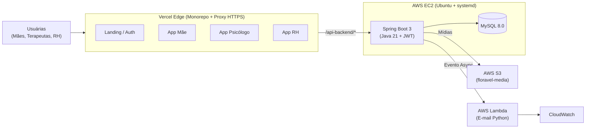

  
  &nbsp;&nbsp;&nbsp;&nbsp;&nbsp;
  

# 🌸 Florável — Acolhimento Perinatal & Saúde Emocional Materna

> *“Quando nasce um bebê, todos os olhares se voltam para ele. Mas quem olha para a mãe?”*  
> Plataforma de apoio à saúde mental materna desenvolvida no **Instituto PROA** para o **Demo Day** — unindo acolhimento humano, impacto social (B2C) e sustentabilidade corporativa ESG (B2B).

---

## 🌐 Portais & Canais Oficiais

| Canal / Portal | Link |
| :--- | :--- |
| 📸 **Instagram** | [@floravel_oficial](https://www.instagram.com/floravel_oficial/) |
| 💼 **LinkedIn** | [Florável no LinkedIn](https://www.linkedin.com/company/flor%C3%A1vel/?viewAsMember=true) |
| 📄 **Dossiê do Projeto** | *[Inserir link do Dossiê aqui](#)* |
| 🌸 **Landing Page** | [froravel-front.vercel.app](https://froravel-front.vercel.app) |
| 🤱 **Portal da Mãe** | [floravel-mae.vercel.app](https://floravel-mae.vercel.app) |
| 🩺 **Portal do Terapeuta** | [psicologo-blue.vercel.app](https://psicologo-blue.vercel.app) |
| 🏢 **Dashboard RH (B2B)** | [rh-lilac-two.vercel.app](https://rh-lilac-two.vercel.app) |

---

## 💔 O Problema: A Dor Invisível da Maternidade

Na gestação e no puerpério, **todos olham para o bebê, mas quase ninguém olha para a mãe**. Por trás dos sorrisos esperados pela sociedade, milhares de mulheres enfrentam solidão, culpa, exaustão e depressão pós-parto em silêncio — muitas vezes sem rede de apoio e sem condições financeiras para buscar terapia.

Em uma das conversas com nossa persona, ouvimos um relato que resume essa invisibilidade: **ela procurou o hospital diversas vezes passando mal, mas em todas ouvia a mesma resposta automática de que “era apenas da gravidez”. Somente na terceira ida descobriu que estava com COVID-19.**

Para confirmar se essa dor era coletiva, fomos a campo no **Instituto PROA**:
* **👩🏾‍🍼 150 respostas de mães:** ouvimos e pesquisamos com mães reais, que relataram a falta de escuta, o medo de serem julgadas e a dificuldade de encontrar ajuda acessível.
* **🧠 Conversas com psicólogos(as):** validamos com profissionais da área a importância do sigilo ético (CFP), da triagem clínica (Escala de Edimburgo - EPDS) e de um cuidado humano acessível.

---

## 🌱 A Solução & Os 3 Pilares da Florável

A Florável nasce para devolver voz, cuidado e pertencimento à mãe através da **conexão com profissionais de saúde mental a valor de baixo custo social**, sustentada por três pilares:

* **🌸 Acolher:** Um espaço seguro onde a mãe encontra conteúdos confiáveis, acolhimento sem julgamentos e a certeza de que é compreendida.
* **🌿 Perceber:** Recursos práticos que a ajudam a reconhecer e acompanhar suas próprias emoções (diário emocional e triagem EPDS com rota imediata de emergência CVV 188 / SAMU 192).
* **🤝 Conectar:** Troca de experiências reais com outras mães em rodas de conversa e comunidade, além da conexão direta com psicólogas verificadas pelo CRP a valor social acessível.

> **Sustentabilidade B2B (ESG):** Empresas patrocinam licenças do programa para suas colaboradoras mães e acompanham indicadores agregados de clima e adesão no Dashboard RH, sem jamais acessar dados clínicos individuais.

---

## 🛠️ Stack Tecnológica

**Front-end (Monorepo)**  
     

**Back-end & Segurança**  
     

**Cloud & Serverless (AWS)**  
     

---

## 🏛️ Arquitetura & System Design

* **Monorepo Desacoplado:** 4 portais independentes compartilhando contratos em `packages/shared`, com proxy HTTPS transparente na Vercel.
* **Privacidade & LGPD:** Senhas em **BCrypt**, minimização de CPF (salvo apenas mascarado), criptografia **AES-256-GCM** em dados sensíveis e **K-Anonimato ($K \ge 5$)** no painel corporativo.
* **Serverless Event-Driven:** Disparo de e-mails desacoplado via **AWS Lambda** para não bloquear a API principal.
* **Ética Clínica:** Zero "robô terapeuta" — triagem determinística (EPDS) e acolhimento exclusivamente por psicólogas humanas.

---

## 👥 Equipe Florável

<!-- Para adicionar a foto geral da equipe:

-->

<table align="center">
  <tr>
    <td align="center" width="200">
       
      <strong>Daniel Expedito</strong> 
      Desenvolvedor 
      <a href="#">LinkedIn</a>
    </td>
    <td align="center" width="200">
       
      <strong>Luiz Gonzaga</strong> 
      Desenvolvedor / UX &amp; UI 
      <a href="#">LinkedIn</a>
    </td>
    <td align="center" width="200">
       
      <strong>Maria Rene</strong> 
      Desenvolvedora 
      <a href="#">LinkedIn</a>
    </td>
    <td align="center" width="200">
       
      <strong>Gabriela Glicelio</strong> 
      Documentarista &amp; Financeiro 
      <a href="#">LinkedIn</a>
    </td>
  </tr>
  <tr>
    <td align="center" width="200">
       
      <strong>Adrielly Soares</strong> 
      Product Owner (P.O.) 
      <a href="#">LinkedIn</a>
    </td>
    <td align="center" width="200">
       
      <strong>Gustavo Kazuhiro</strong> 
      Desenvolvedor 
      <a href="#">LinkedIn</a>
    </td>
    <td align="center" width="200">
       
      <strong>Victor</strong> 
      Scrum Master 
      <a href="#">LinkedIn</a>
    </td>
    <td align="center" width="200">
       
      <strong>Gabriel</strong> 
      Desenvolvedor 
      <a href="#">LinkedIn</a>
    </td>
  </tr>
</table>

---

## 🙏 Agradecimentos

Mais do que um projeto de tecnologia, o **Florável** marcou um dos momentos mais especiais da nossa trajetória no **Instituto PROA**. Cada linha de código, cada tela desenhada e cada entrevista carrega histórias reais, superação e muita amizade.

### À Nossa Equipe & À Turma 5 (Equipe 5)
* **Aos 8 integrantes da Florável:** **Daniel Expedito**, **Luiz Gonzaga**, **Maria Rene**, **Gabriela Glicelio**, **Adrielly Soares**, **Gustavo Kazuhiro**, **Victor** e **Gabriel** — obrigado por nunca soltarem a mão um do outro nos momentos de pressão, por transformarem noites cansativas em aprendizado e por acreditarem desde o primeiro dia que podíamos criar algo com propósito real.
* **À Equipe 5 e às demais equipes da Turma 5 de Java:** nosso carinho e gratidão imensa a todos os colegas que dividiram essa caminhada com a gente. Obrigado por cada ensinamento compartilhado, pelas trocas entre equipes, pelas dicas nos momentos em que o código travava e, acima de tudo, por tornarem o nosso ambiente muito mais leve, acolhedor e divertido todos os dias.

### Aos Professores que Fizeram Parte dessa História
* **Gabriel Augusto** *(Professor da Turma 5 de Java)* — foi quem passou mais tempo ao nosso lado nessa jornada. Obrigado de coração por cada ensinamento, por cada dica que nos destravou e por dedicar tanto do seu tempo e paciência para nos ver crescer como profissionais e como pessoas.
* **Débora** — obrigado por acreditar no nosso projeto, por toda a ajuda na construção do **pitch** e por tornar possível as **aulas de AWS** para as turmas do PROA, que foram decisivas para colocarmos o Florável na nuvem.
* **Aurora** *(Professora de Comunicação)* — obrigado pelas aulas de português, pelo cuidado com os nossos currículos e por nos ensinar a comunicar nossa história e nosso pitch com confiança e verdade.
* **Cláudia** *(Professora de Projeto)* — obrigado pela forma humana e organizada como conduziu toda a sequência do projeto até o resultado final e a grande apresentação do **Demo Day**.

> *Levaremos o aprendizado, os laços construídos e o orgulho de ter vivido essa jornada no **Instituto PROA** para toda a vida.* 🌸💚
